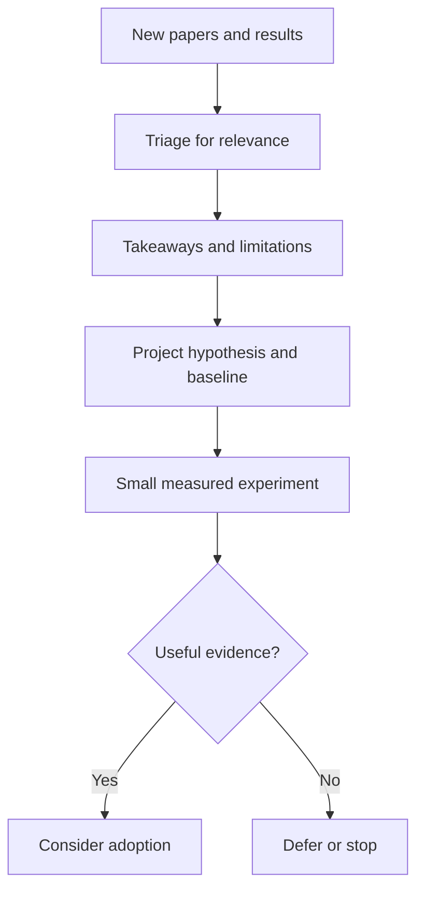

Most of my software experiments begin with something modest, occasionally silly. I wanted a security-minded GitHub profile image. I wanted a little UNIX humor in website footers. Neither started with a product roadmap.

What changed was access to research—and the ability to use AI to explore it. Papers that once demanded hours of specialist reading can now be approached more quickly, compared with related work, and translated into questions relevant to an actual project.

**AI doesn't turn a small tool into a product by itself. It makes more possible directions worth investigating—and gives us better ways to decide which ones deserve further work.**

## Reading papers for something useful

A summary is a starting point, not the outcome. When I work through a paper with AI, I ask:

- **What did the researchers actually establish?** Separate measured results from hypotheses and future work.
- **Which assumptions and limitations matter?** A result on a controlled dataset may not survive ordinary inputs or real-world handling.
- **Where does it intersect with a project?** Identify a specific capability, constraint, or unanswered question.
- **What could we try next?** Extract a small, testable hypothesis rather than adopting an entire architecture.

A paper becomes useful when its claims meet a real project constraint. Sometimes a conclusion suggests a new feature. Sometimes a limitation reveals a better approach. Sometimes the right takeaway is to stop pursuing an attractive idea.

## Research also gives us guardrails

Research can inform **benchmarks, performance budgets, and acceptance criteria**, not just ideas. The objective is to turn a promising claim into an observable comparison against the current implementation.

For **Veil**, that might mean measuring exact, byte-for-byte recovery; recoverable capacity; total artifact size including metadata; visual quality; encode/decode latency and peak memory; and failure under resizing or recompression. An interesting image is not evidence that encrypted recovery works.

For **Fortunes**, a benchmark is less mechanical: technical accuracy, novelty, duplicates, audience-rated humor, relevance to a particular team, and generation cost and human review effort per accepted fortune. Model self-ratings aren't a substitute for readers.

Those are **candidate evaluation dimensions**, not claims that either project already meets them. The paper's own benchmark isn't automatically ours. We still need representative inputs, a baseline, explicit pass/fail criteria, and repeatable measurements. Security or privacy claims need their own evidence.

## Keeping up without chasing every paper

The discovery stage can become a lightweight monitoring pipeline: watch relevant publications, filter duplicates, extract findings and limitations, connect them to active projects, and surface only the research that might change a decision.

Monitoring can help with discovery. It shouldn't automatically turn every paper into an issue, a dependency, or a production change. Human judgment still determines relevance, review, and whether a finding justifies the maintenance cost.

## Two small examples

[Veil](/blog/veil-encrypted-obfuscation) began as a geometric profile-image experiment. Research now suggests a harder possibility: **encrypt the exact original and embed it inside the obfuscation itself**, with a related direction for text. That has not been demonstrated as a shipping recovery feature.

[Fortunes](/blog/fortunes-modern-unix-humor) began as an API for footer jokes. Research now raises the possibility of **automatically discovering modern UNIX-style humor**, including a corpus grounded in a particular team's approved technology and culture. That generation workflow is not a shipping feature either.

The projects ask different questions. What connects them is the method: follow the research, extract what applies, try the smallest useful experiment, and let measured results—not AI's confidence—decide what comes next.
