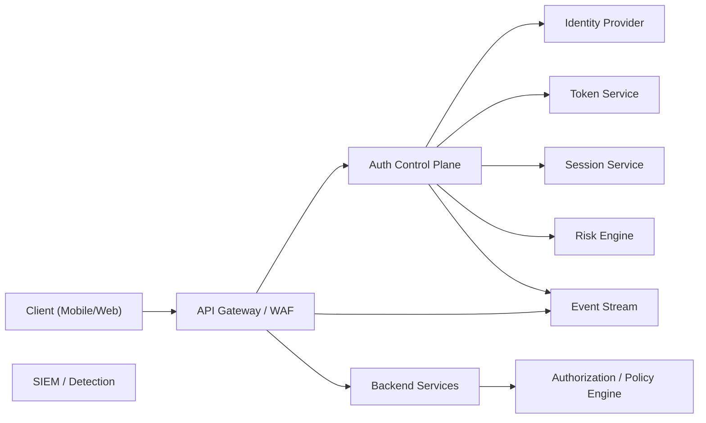
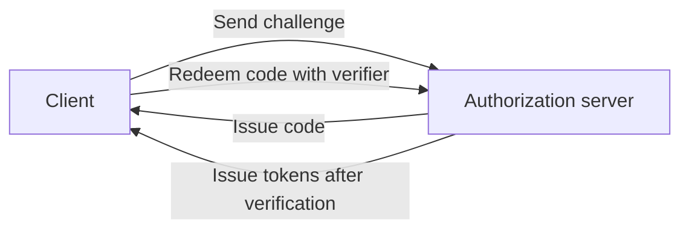
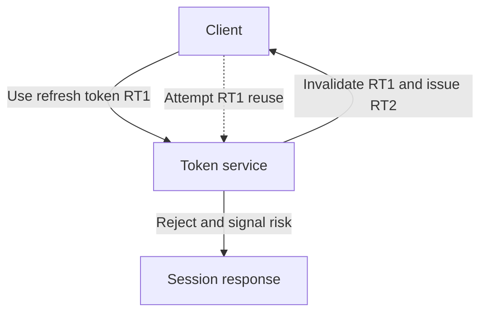
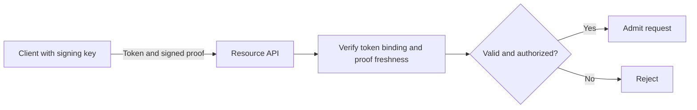

_By Ryan Jennings. Adapted for Micrantha Architecture Notes from [the personal edition](https://ryanjennin.gs/posts/secure-auth-systems-reference/), which remains the canonical source._

<Figure
  title="Designing Secure Authentication Systems"
  caption="Authentication separates identity, tokens, sessions, authorization, and operational detection."
  src="/img/blog/secure-auth-systems-reference.webp"
  alt="Illustration for a secure authentication reference architecture."
/>

Most authentication systems are secure—until they meet production reality.

They pass audits, follow OAuth/OIDC correctly, use JWTs, enforce TLS. Then they get exposed to:

- credential stuffing at scale
- mobile clients being reverse engineered
- tokens leaking through logs or memory
- sessions persisting longer than intended
- recovery flows bypassing stronger controls

At that point, security stops being about protocol correctness and becomes about **system behavior under pressure**.

This article focuses on what actually holds up: where systems fail, which components absorb those failures, and how to design authentication as a **controllable, observable system** rather than a one-time verification step.

Where this article includes "Field Notes" sections, those observations come
from my own experience across enterprise, product, and contract software work,
in addition to the standards and reference material that inform the rest of the
article.

---

## Authentication Is a System, Not a Feature

A typical flow crosses multiple boundaries:

- mobile/web clients (untrusted)
- API gateway (first enforcement)
- authentication control plane (identity, tokens, sessions)
- backend services (authorization)
- monitoring and incident response

Each layer introduces failure modes. Security emerges from how these layers **constrain, observe, and revoke** trust.

> Secure authentication depends as much on architecture and operations as on cryptographic protocols.

> **Most authentication systems are designed to verify identity once.
> Secure systems are designed to survive ongoing compromise.**

---

## Threat Model (What Actually Happens)

Assume all of the following will occur:

- credential theft (phishing, reuse)
- token theft (logs, memory, compromised devices)
- token replay
- session hijacking
- automated abuse (credential stuffing, bots)
- targeted account takeover (admins, high-value users)

Design assumption:

> Some credentials and sessions will be compromised. The system must limit damage, detect it, and contain it quickly.

That same posture applies to engineering tooling itself. If your teams are using
AI across delivery, the supply-chain analogue is
[Threat Modeling AI as an Engineering Coprocessor](https://ryanjennin.gs/posts/threat-modeling-ai-engineering-coprocessor/).

---

## Reference Architecture (Control Planes and Boundaries)

A hardened system separates responsibilities into planes:

- **Edge Enforcement**: CDN/WAF, API gateway, rate limits
- **Authentication Control Plane**: identity, MFA/passkeys, tokens, sessions, risk
- **Application Plane**: business APIs + authorization
- **Security Plane**: telemetry, detection, response

Trust boundaries:

- **Client**: untrusted (programmable by the attacker)
- **Edge**: first enforcement boundary
- **Control Plane**: source of trust artifacts
- **Application**: consumes verified identity
- **Security**: detects and contains failures

Key idea:

> Trust is minted in the control plane and continuously evaluated at runtime.

---

## Components (What Actually Exists)

### Client Layer (Untrusted)

Treat the client as an instrumented adversarial environment.

> **The client is not a security boundary.
> It is a signal generator at best, and an attacker-controlled environment at worst.**

**Auth Flow Controller**

- PKCE verifier lifecycle
- redirect handling
- token exchange
- refresh orchestration (single-flight)

Failure modes:

- verifier leakage (logs/memory)
- redirect hijacking
- parallel refresh races

**Token Storage**

- memory-only when feasible, accounting for browser XSS and application lifecycle risks
- platform-protected secure storage when persistence is required
- avoid unprotected filesystem storage

Reality: secure storage reduces risk but does not eliminate it on compromised devices.

> **Anything stored on a mobile device should be assumed extractable under the right conditions.**

**Secure Hardware Interface**

- Secure Enclave / StrongBox / platform authenticators
- non-exportable keys, user-presence gating

**Network Layer**

- attaches tokens, handles refresh/retries
- avoid token leakage in logs; guard against retry storms

**Device Signals & Attestation**

- device/app signals, attestation (App Attest / Play Integrity)
- use as probabilistic inputs, not hard trust

> The client may help prove identity, but must never enforce authorization.

---

### Edge / Gateway

- validate tokens (signature/expiry)
- check session/revocation state
- rate limit (IP/account/device)
- bot detection, geo controls

Most volumetric attacks should die here.

---

### Authentication Control Plane

**Auth Orchestrator**

- login, MFA/passkeys, recovery, step-up

**Identity Provider**

- users, credentials, passkeys, account state

**Token Service**

- access/refresh tokens, signing, expiry

**Session Service (backbone)**

- session inventory, device mapping
- token families, revocation state

**Risk Engine**

- anomaly detection, risk scoring, step-up triggers

> Modern authentication systems increasingly rely on risk scoring systems that aggregate signals across sessions, devices, and behavior.
>
> At scale, this becomes a fraud detection problem rather than a pure authentication problem.

**Device Signals (First-Class Inputs)**

- device fingerprint (coarse, privacy-aware)
- OS/app version, patch level
- attestation (App Attest / Play Integrity / SafetyNet legacy)
- hardware-backed key presence

**How they’re used**

- contribute to risk score (not hard allow/deny)
- detect new/unknown devices
- influence step-up decisions and session trust

> Device signals are not a trust boundary. They are probabilistic evidence that improves detection and response.

---

### Application Plane

- backend services enforce authorization
- policy engine (RBAC/ABAC/context)

---

## Authentication vs Authorization (AuthN vs AuthZ)

These are distinct concerns and should be separated architecturally.

- **Authentication (AuthN)**: who the subject is (identity proof, tokens, sessions)
- **Authorization (AuthZ)**: what the subject can do (policies, permissions, resource access)

> Conflating AuthN and AuthZ leads to brittle systems (e.g., encoding business permissions directly in long‑lived tokens).

### Authorization Models

**RBAC (Role-Based Access Control)**

- users assigned roles; roles map to permissions
- simple, auditable, coarse-grained
- pitfalls: role explosion, poor context handling

**ABAC (Attribute-Based Access Control)**

- decisions based on attributes (user, resource, environment)
- supports context (device, risk score, time)
- pairs well with policy engines (e.g., OPA)

**MAC (Mandatory Access Control)**

- centrally enforced labels/classifications
- common in high-assurance/government systems

**Practical guidance**

- use RBAC for baseline permissions
- layer ABAC for context/risk-aware decisions (step-up, sensitive actions)
- keep AuthZ **server-side**; never trust client claims alone

---

### Security Infrastructure

- KMS/HSM (signing keys, rotation)
- revocation cache (fast enforcement)
- event stream (auth/session telemetry)
- SIEM (detection/alerting)
- audit logs (forensics)

---

## Protocols and Where They Fit (SAML, OAuth, OIDC)

Protocols define how identity is asserted and delegated across systems. They do not replace architecture.

**OAuth 2.0 (Authorization Framework)**

- purpose: delegated access to APIs
- outputs: access tokens (and refresh tokens)
- does **not** define identity by itself

**OpenID Connect (OIDC)**

- identity layer on top of OAuth 2.0
- outputs: ID Token (identity claims) + OAuth tokens
- typical for modern web/mobile SSO

**SAML 2.0**

- XML-based federation protocol
- commonly used for enterprise/legacy SSO (IdP ↔ SP)
- browser/redirect heavy; less suited for modern mobile/API patterns

### How They Map to the System

- **SAML / OIDC**: federation into your **Identity Provider** (who is the user)
- **OAuth**: delegation from client to **APIs** (what can be accessed)
- **Your control plane**: issues tokens, manages sessions, enforces risk and revocation

> Protocol choice does not solve token lifecycle, session control, or abuse—those are architectural responsibilities.

---

## Token Architecture (What Determines Blast Radius)

### Token Types

**Access tokens**

- short-lived according to risk and revocation design (often minutes)
- bearer or sender-constrained proof-of-possession

**Refresh tokens**

- potentially longer-lived than access tokens, but revocable and appropriately scoped
- for public clients, require rotation with reuse detection or sender constraint when refresh tokens are issued

**Session records**

- authoritative state (user ↔ device ↔ token family)

---

### PKCE (What It Solves—and Doesn’t)

PKCE mitigates code interception and injection by binding code redemption to the original verifier. It does not replace redirect validation, issuer binding, state/nonce where appropriate, or token lifecycle controls.

Limitations:

- does not prevent phishing
- does not protect tokens post-issuance

---

### Refresh Token Rotation (and Detection)

> **A long-lived bearer refresh token without rotation or sender constraint increases replay risk.**

If RT1 is reused after rotation → strong compromise signal.

Required response:

- revoke session family
- emit security event

### Field Notes (What Breaks in Practice)

- Systems **omit refresh tokens** and rely on user-triggered failures (401 → re-login). This removes server control and visibility over session lifecycle.
- Clients attempt to **generate encryption keys locally** (e.g., for token protection) using weak or reproducible entropy. This collapses the protection model.
- Datastores occasionally contain **plaintext or reversibly encrypted credentials**. This is a catastrophic failure regardless of upstream controls.

**Practical guidance**

- When issuing refresh tokens, use **rotation with reuse detection or sender constraint**, plus server-side revocation. Coordinate refresh through a controlled client flow, not UI error prompts.
- Never rely on client-generated keys for long-term secrecy; prefer **hardware-backed keys** or server-side controls.
- Store credentials using **strong, adaptive hashing** (e.g., Argon2/bcrypt with proper parameters) and treat the database as eventually exposed.

> **If your credential store is compromised, every upstream control is irrelevant.
> Hashing is not optional—it is the last line of defense.**

---

### Proof of Possession (PoP)

Bearer tokens are replayable.

PoP binds tokens to a key (e.g., DPoP, mTLS).

Trade-offs:

- higher complexity
- strong replay resistance

---

> **Bearer tokens are credentials.
> If they can be copied, they can be replayed. Design accordingly.**

### Practical “Strong” Token Model

- short-lived access tokens
- rotating refresh tokens with reuse detection
- server-side session tracking
- optional PoP for high-risk APIs

---

## Biometrics Done Correctly

Correct model:

biometric → unlock hardware key → sign challenge → server verifies

Anti-pattern:

biometric → unlock stored token

Properties:

- biometric never leaves device
- server trusts cryptographic proof
- credentials are device-bound

> **Biometric verification is local user verification, not independently sufficient server-side authorization.**
> In passkey or hardware-backed challenge flows, the server trusts the cryptographic assertion, not a biometric sample.

### Field Notes (Common Failure Modes)

- Storing **encrypted passwords locally** and unlocking them with biometrics. On jailbroken/rooted devices this is often extractable or bypassable.
- Using biometrics as a **UI gate only** (e.g., a prompt with no hardware-backed key). This is trivial to bypass with instrumentation.
- Fragmentation across devices/OS versions creates **inconsistent guarantees** and UX. Security properties vary more than teams expect.

**Practical guidance**

- Tie biometrics to **hardware-backed keys**, not stored secrets.
- Treat device compromise as possible; rely on **server-side controls** (sessions, step-up) to contain damage.
- Keep the UX consistent, but design assuming **heterogeneous security capabilities**.

---

## Sessions: The Hidden Backbone

Stateless-only systems lack control.

**Stateful sessions provide:**

- revocation
- visibility
- incident response

Recommended hybrid:

- stateless access tokens
- stateful session + refresh tracking

> **Stateless authentication scales well—until you need to revoke trust.**

> Authentication verifies identity; sessions verify ongoing trust.

---

## Attack → Failure → Control (Compressed Map)

- **phishing** — weak auth factors: passkeys / phishing-resistant MFA
- **code interception** — redirect flow: PKCE
- **access token theft** — client storage/logging: short TTL / PoP
- **refresh token theft** — lifecycle design: rotation + reuse detection
- **session hijack** — no session control: session state + revocation
- **replay** — bearer model: PoP
- **mobile tampering** — trusting client: backend enforcement
- **credential stuffing** — no throttling: rate limits + bot defense
- **recovery abuse** — weak recovery: hardened recovery flows

---

## Defense in Depth (What Actually Helps)

Layers:

1. identity verification
2. token issuance
3. session tracking
4. behavioral analysis
5. operational response

Controls:

- rate limiting and throttling
- anomaly detection (location, device, behavior)
- MFA and step-up for sensitive actions
- device trust signals
- comprehensive telemetry

> Static controls (rate limits, MFA) are necessary but insufficient at scale.
>
> Mature systems incorporate **adaptive authentication**, where access decisions are continuously adjusted based on behavioral signals and evolving risk scores.

---

## Operational Security (Where Systems Win or Lose)

Required capabilities:

- immediate session revocation
- forced logout (user/all devices)
- credential reset workflows
- real-time monitoring

Key signals:

- refresh token reuse
- impossible travel
- new device anomalies
- abnormal API patterns

Without visibility and response, attacks are silent.

> Many large-scale systems incorporate machine learning models to detect subtle anomalies (e.g., session drift, behavioral deviation).
>
> These systems extend detection beyond static rules, but do not replace strong architectural controls.

### Field Notes (Mobile Networking Realities)

- **Certificate pinning** is effective but brittle: app updates lag certificate rotations, leading to outages or forced disables.
- Static pinning strategies create **operational risk** during cert rollover or CA changes.

**Practical guidance**

- Prefer **pinning to public keys** (SPKI) with backup pins.
- Implement **graceful rotation** (overlapping pins) and remote configuration where feasible.
- Treat pinning as a **defense-in-depth layer**, not a sole control; assume bypass is possible on compromised devices.

> **Certificate pinning increases security—but also increases the cost of failure.
> Plan for rotation, not just validation.**

---

## Supply Chain and Dependency Risk

Authentication systems increasingly depend on external components:

- mobile SDKs
- identity providers
- cryptographic libraries
- fraud detection services

These introduce supply chain risk:

- outdated or unpatched dependencies
- unclear ownership of critical libraries
- inconsistent rollout across platforms/teams
- hidden transitive dependencies affecting security posture

> A secure authentication design can be undermined by an untracked or outdated dependency.

**Practical guidance**

- maintain a **software bill of materials (SBOM)** for auth-related components
- enforce **version visibility and upgrade policies**
- ensure **critical SDKs are observable in production (version, health)**
- treat auth dependencies as **high-risk assets**, not just libraries

---

## Applying Secure Design Principles (CSSLP Perspective)

Authentication systems benefit from applying structured secure design principles:

### Least Privilege

- scope tokens narrowly
- restrict session capabilities
- limit blast radius of compromise

### Defense in Depth

- layer controls (client, edge, control plane, session, risk)
- assume any single layer can fail

### Secure by Default

- short-lived tokens
- rotation enabled
- strong hashing enforced

### Fail Securely

- deny on ambiguity (invalid tokens, missing context)
- avoid fallback paths that weaken authentication

### Complete Mediation

- validate authentication and authorization on every request
- do not trust cached or client-provided state

### Separation of Concerns

- separate authentication, session, and authorization logic
- isolate key management and token signing

### Economy of Mechanism

- avoid overly complex auth flows
- complexity increases bypass risk (especially client-side)

### Open Design

- rely on proven protocols and primitives
- avoid security through obscurity

### Psychological Acceptability

- consistent UX across auth flows
- reduce user-driven bypass (e.g., MFA fatigue)

> Many authentication failures are not due to missing controls, but due to violations of these foundational principles.

---

## Common Architectural Failures

- long-lived tokens
- no revocation mechanism
- trusting mobile/client enforcement
- weak recovery flows
- lack of telemetry
- no session inventory

These are architectural issues, not protocol issues.

---

## What Hardened Systems Do Differently

- device-bound credentials (passkeys)
- short-lived tokens with rotation
- session state with visibility and control
- continuous risk evaluation
- step-up authentication for sensitive actions
- fast revocation paths
- integrated telemetry and detection

They treat authentication as a **continuous trust system**, not a one-time event.

---

## Authentication Becomes Fraud Detection at Scale

As systems grow, authentication shifts from a one-time decision to a continuous evaluation:

identity (who are you?)
→ session (are you still you?)
→ behavior (are you acting like you?)

Characteristics:

- trust becomes **probabilistic and time-varying**
- decisions become **contextual** (device, location, behavior)
- controls become **adaptive** (step-up, throttling, containment)

Device signals are a key input here, but not decisive on their own. They improve signal quality when combined with:

- historical behavior
- session continuity
- network and geo context

### Field Notes (Supply Chain Blind Spots)

In practice, fraud and adaptive systems are only as strong as their weakest integration point.

A recurring failure mode is when critical client-side or SDK components:

- are **not tracked as part of the supply chain**
- are **obscured or renamed**, making ownership unclear
- become **outdated and difficult to upgrade across teams**

This creates a hidden risk surface:

- inconsistent signal quality
- broken or stale attestation
- degraded fraud detection accuracy

Worse, these issues are often discovered during incidents, not proactively.

**Practical guidance**

- Treat authentication and fraud-related SDKs as **first-class supply chain dependencies**
- Maintain **clear ownership and version visibility**
- Enforce **upgrade paths and deprecation policies**
- Ensure signals are **observable and verifiable in production**

> Architecture provides guarantees; fraud/risk systems provide detection and adaptation. You need both.

---

## Final Mental Model

Identity → Tokens → Sessions → Behavior → Trust

Each stage must:

- validate
- constrain
- observe
- revoke

---

> **Authentication is not about proving identity.
> It is about maintaining trust in a system that is actively being attacked.**

## Closing

Authentication is not about proving identity once.

It is about maintaining trust under continuous adversarial pressure—across devices, tokens, sessions, and behavior.

Systems that succeed are not those that implement the right protocol, but those that:

- limit the impact of inevitable compromise
- detect abnormal behavior quickly
- and revoke trust without friction when needed

Everything else is just implementation detail.

---

## References

### Author Background

- [LinkedIn: Ryan Jennings](https://linkedin.com/in/ryjen) for the professional background behind the field notes and operational commentary in this article.

### Authentication System Design Foundations

- [NIST Digital Identity Guidelines (SP 800-63 Suite)](https://www.nist.gov/itl/applied-cybersecurity/special-publication-800-63) for the overarching system model covering identity proofing, authentication, federation, and assurance levels.
- [NIST SP 800-63B-4: Authentication and Authenticator Management](https://www.nist.gov/publications/nist-sp-800-63b-4digital-identity-guidelines-authentication-and-authenticator) for modern authentication lifecycle guidance, authenticator strength, phishing resistance, and recovery design.
- [RFC 9700: Best Current Practice for OAuth 2.0 Security](https://www.rfc-editor.org/rfc/rfc9700) for modern OAuth architecture and current operational security guidance.
- [OWASP ASVS](https://owasp.org/www-project-application-security-verification-standard/) for structured verification requirements across authentication, session management, and access control.
- [OWASP Authentication Cheat Sheet](https://cheatsheetseries.owasp.org/cheatsheets/Authentication_Cheat_Sheet.html) for practical authentication architecture and implementation guidance.
- [OWASP Session Management Cheat Sheet](https://cheatsheetseries.owasp.org/cheatsheets/Session_Management_Cheat_Sheet.html) for session lifecycle, revocation, and ongoing trust management.

### Internal Reading

- [Modern Mobile Hardening](https://ryanjennin.gs/posts/modern-mobile-hardening/) for the companion mobile-security model behind the client, attestation, and pinning sections in this article.
- [Friday Frida Hacking without the Why](https://ryanjennin.gs/posts/friday-frida-hack/) for runtime instrumentation context and why client trust collapses quickly on compromised devices.
- [Man-in-the-Middle](https://ryanjennin.gs/posts/mitm/) for transport-layer attacks, interception mechanics, and TLS realities.

### Core Identity and Protocol Standards

- [RFC 9700: Best Current Practice for OAuth 2.0 Security](https://www.rfc-editor.org/rfc/rfc9700) for current OAuth security guidance and deprecations.
- [RFC 6749: The OAuth 2.0 Authorization Framework](https://www.rfc-editor.org/rfc/rfc6749) for the base OAuth model.
- [RFC 7636: Proof Key for Code Exchange (PKCE)](https://www.rfc-editor.org/rfc/rfc7636) for public-client authorization code protection.
- [RFC 6819: OAuth 2.0 Threat Model and Security Considerations](https://www.rfc-editor.org/rfc/rfc6819) for the historical threat model that still informs many implementation patterns.
- [RFC 8252: OAuth 2.0 for Native Apps](https://www.rfc-editor.org/rfc/rfc8252) for native-client redirect handling and browser-based auth guidance.
- [OpenID Connect Core 1.0](https://openid.net/specs/openid-connect-core-1_0.html) for identity-layer behavior on top of OAuth 2.0.

### Token, Session, and Replay Security

- [RFC 9449: OAuth 2.0 Demonstrating Proof-of-Possession at the Application Layer (DPoP)](https://www.rfc-editor.org/rfc/rfc9449) for proof-of-possession token design.
- [RFC 7519: JSON Web Token (JWT)](https://www.rfc-editor.org/rfc/rfc7519) for token structure and claim semantics.
- [RFC 7009: OAuth 2.0 Token Revocation](https://www.rfc-editor.org/rfc/rfc7009) for revocation endpoints and token invalidation patterns.
- [RFC 7662: OAuth 2.0 Token Introspection](https://www.rfc-editor.org/rfc/rfc7662) for stateful token validation and control-plane visibility.

### Passwords, MFA, and Passkeys

- [OWASP Password Storage Cheat Sheet](https://cheatsheetseries.owasp.org/cheatsheets/Password_Storage_Cheat_Sheet.html) for hashing and credential storage requirements.
- [NIST SP 800-63B: Authentication and Lifecycle Management](https://pages.nist.gov/800-63-4/sp800-63b.html) for authenticator assurance, phishing resistance, and lifecycle guidance.
- [WebAuthn Level 3](https://www.w3.org/TR/webauthn-3/) for passkeys and phishing-resistant public-key authentication.
- [FIDO Alliance Passkeys](https://fidoalliance.org/passkeys/) for passkey ecosystem guidance and deployment context.

### Mobile and Platform Security

- [OWASP MASVS](https://mas.owasp.org/MASVS/)
- [OWASP MASTG](https://mas.owasp.org/MASTG/)
- [OWASP Certificate and Public Key Pinning](https://owasp.org/www-community/controls/Certificate_and_Public_Key_Pinning)
- [OWASP MASTG: Certificate Pinning](https://mas.owasp.org/MASTG/knowledge/android/MASVS-NETWORK/MASTG-KNOW-0015/)
- [OWASP MASTG: Local Authentication Framework](https://mas.owasp.org/MASTG/knowledge/ios/MASVS-AUTH/MASTG-KNOW-0056/) for mobile local-auth and biometric implementation context.
- [OWASP MASTG: Keychain Services](https://mas.owasp.org/MASTG/knowledge/ios/MASVS-AUTH/MASTG-KNOW-0057/) for Apple-side secure local storage and protected-secret retrieval context.
- [Google Play Integrity API Overview](https://developer.android.com/google/play/integrity/overview)
- [Apple DeviceCheck](https://developer.apple.com/documentation/devicecheck)
- [Apple App Attest](https://developer.apple.com/documentation/devicecheck/establishing_your_app_s_integrity)
- [Android Keystore](https://developer.android.com/privacy-and-security/keystore)
- [Android BiometricPrompt](https://developer.android.com/identity/sign-in/biometric-auth)
- [Apple Keychain Services](https://developer.apple.com/documentation/security/keychain_services)
- [Apple LocalAuthentication](https://developer.apple.com/documentation/localauthentication)
- [Apple Platform Security: Secure Enclave](https://support.apple.com/guide/security/secure-enclave-sec59b0b31ff/web)

### Operational Security and Supply Chain

- [OWASP Secrets Management Cheat Sheet](https://cheatsheetseries.owasp.org/cheatsheets/Secrets_Management_Cheat_Sheet.html) for key, secret, and operational credential handling.
- [OWASP Logging Cheat Sheet](https://cheatsheetseries.owasp.org/cheatsheets/Logging_Cheat_Sheet.html) for telemetry without sensitive-data leakage.
- [Sigstore](https://www.sigstore.dev/) for artifact signing and provenance verification.
- [SLSA](https://slsa.dev/) for supply-chain maturity and build integrity guidance.
- [CycloneDX](https://cyclonedx.org/) for SBOM structure and dependency inventory practices.

### References by Section

- **Threat model and control-plane architecture**: [RFC 9700: Best Current Practice for OAuth 2.0 Security](https://www.rfc-editor.org/rfc/rfc9700), [RFC 6819: OAuth 2.0 Threat Model and Security Considerations](https://www.rfc-editor.org/rfc/rfc6819), [OWASP ASVS](https://owasp.org/www-project-application-security-verification-standard/)
- **Client layer, native apps, and public-client constraints**: [RFC 8252: OAuth 2.0 for Native Apps](https://www.rfc-editor.org/rfc/rfc8252), [Modern Mobile Hardening](https://ryanjennin.gs/posts/modern-mobile-hardening/)
- **PKCE and redirect-flow protection**: [RFC 7636: Proof Key for Code Exchange (PKCE)](https://www.rfc-editor.org/rfc/rfc7636), [RFC 6749: The OAuth 2.0 Authorization Framework](https://www.rfc-editor.org/rfc/rfc6749)
- **Refresh tokens, revocation, and session control**: [RFC 7009: OAuth 2.0 Token Revocation](https://www.rfc-editor.org/rfc/rfc7009), [RFC 7662: OAuth 2.0 Token Introspection](https://www.rfc-editor.org/rfc/rfc7662), [OWASP Session Management Cheat Sheet](https://cheatsheetseries.owasp.org/cheatsheets/Session_Management_Cheat_Sheet.html)
- **Replay resistance and proof of possession**: [RFC 9449: OAuth 2.0 Demonstrating Proof-of-Possession at the Application Layer (DPoP)](https://www.rfc-editor.org/rfc/rfc9449), [RFC 7519: JSON Web Token (JWT)](https://www.rfc-editor.org/rfc/rfc7519)
- **Biometrics, passkeys, and phishing-resistant MFA**: [NIST SP 800-63B: Authentication and Lifecycle Management](https://pages.nist.gov/800-63-4/sp800-63b.html), [WebAuthn Level 3](https://www.w3.org/TR/webauthn-3/), [FIDO Alliance Passkeys](https://fidoalliance.org/passkeys/)
- **Mobile attestation, local auth, and key custody**: [OWASP MASVS](https://mas.owasp.org/MASVS/), [OWASP MASTG](https://mas.owasp.org/MASTG/), [Google Play Integrity API Overview](https://developer.android.com/google/play/integrity/overview), [Apple App Attest](https://developer.apple.com/documentation/devicecheck/establishing_your_app_s_integrity), [Android Keystore](https://developer.android.com/privacy-and-security/keystore), [Apple Keychain Services](https://developer.apple.com/documentation/security/keychain_services)
- **Password handling and credential storage**: [OWASP Password Storage Cheat Sheet](https://cheatsheetseries.owasp.org/cheatsheets/Password_Storage_Cheat_Sheet.html), [OWASP Authentication Cheat Sheet](https://cheatsheetseries.owasp.org/cheatsheets/Authentication_Cheat_Sheet.html)
- **Operational response, pinning, and mobile transport realities**: [OWASP Certificate and Public Key Pinning](https://owasp.org/www-community/controls/Certificate_and_Public_Key_Pinning), [OWASP MASTG: Certificate Pinning](https://mas.owasp.org/MASTG/knowledge/android/MASVS-NETWORK/MASTG-KNOW-0015/), [Man-in-the-Middle](https://ryanjennin.gs/posts/mitm/)
- **Supply chain and observability**: [OWASP Logging Cheat Sheet](https://cheatsheetseries.owasp.org/cheatsheets/Logging_Cheat_Sheet.html), [OWASP Secrets Management Cheat Sheet](https://cheatsheetseries.owasp.org/cheatsheets/Secrets_Management_Cheat_Sheet.html), [Sigstore](https://www.sigstore.dev/), [SLSA](https://slsa.dev/), [CycloneDX](https://cyclonedx.org/)
