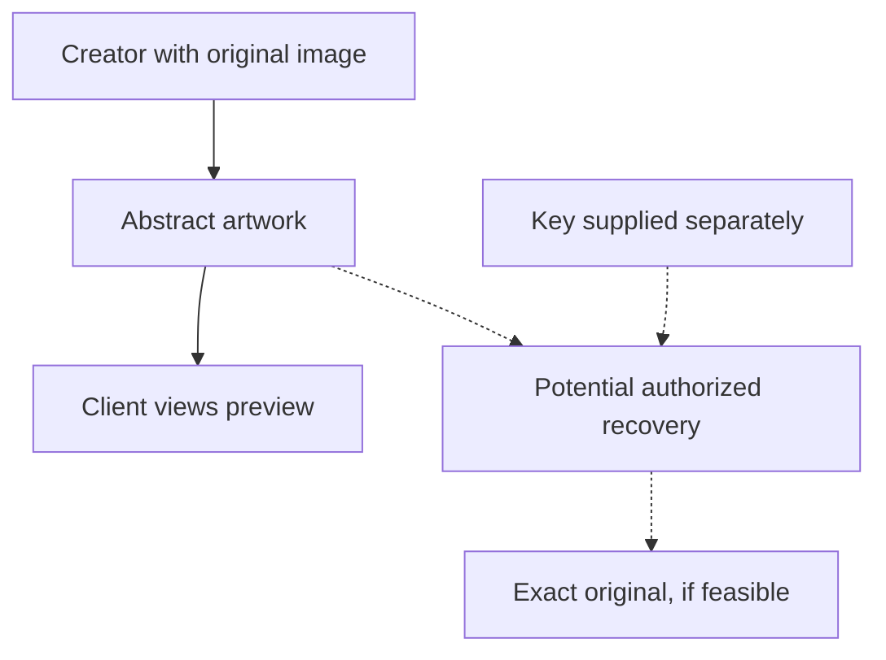

A visually abstracted image, an apparently ordinary passage of text, and a sarcastic UNIX fortune may not appear to have much in common. All three raise an interesting question: **can changing the form of information reveal something new while preserving what matters?**

At [Micrantha](https://micrantha.com), two projects are exploring different sides of that question. [Veil](https://veil.micrantha.com) currently transforms images and is researching recoverability across visual and written content. [Fortunes](https://fortunes.micrantha.com) delivers short, often irreverent observations rooted in UNIX culture.

The products exist today. The capabilities discussed below are **research goals, not features being advertised as available**. This is an overview for people evaluating the products, potential collaborators, and engineers interested in the decisions behind the work—not an implementation specification.

## Veil: can abstraction and controlled recovery coexist?

**What exists today.** Veil turns images into abstract, Voronoi-style artwork. That transformation is one-way: it discards image information, and the resulting artwork cannot be used to reconstruct the exact source.

### See the transformation

This before-and-after pair comes from an existing Veil CLI demonstration. It shows the **current one-way transformation**—not encryption or recoverable-image functionality.

<Figure
  title="Original example"
  caption="Source photograph from Veil's existing CLI demonstration."
  src="/img/blog/veil-cli-original.jpg"
  alt="Original photographic portrait of a person against a neutral background."
  narrow
/>

<Figure
  title="Veil's one-way transformation"
  caption="The matching geometric mosaic generated by the Veil CLI from that photograph. This output is not reversible."
  src="/img/blog/veil-cli-obfuscated.jpg"
  alt="The same portrait transformed into an abstract mosaic of colored Voronoi cells."
  narrow
/>

**What we're investigating.** The longer-term goal is a visually transformed, shareable image that an authorized person could restore to its original form using a separately held encryption key. The ambition is to make the transformed image useful for viewing while preserving a controlled path back to the original.

**A possible customer experience.** A photographer shares an abstract preview of an unreleased image with a prospective client. The client can appreciate the artwork without special software. The longer-term ambition is that an authorized recipient could receive a separately supplied key and recover the original from the same intact artifact. That final step is **research, not an available feature**.

Whether the proposed experience is practical in file size, image compatibility, and recovery reliability remains an **open research question**.

There are important limits. Artistic obfuscation is **not secure redaction or anonymity**; a viewer may still infer details from an image. Encrypting recoverable data would not make everything visible in the transformed image private. And key-based recovery depends on the integrity of the protected information, not just the visual appearance of the result.

### Extending the question to text

Veil is also studying whether writing could be transformed into a **readable abstraction** while retaining a separately protected, encrypted version of the original. Imagine sharing a short, generalized account of a sensitive passage while someone holding the appropriate key could recover the exact original wording from an intact, self-contained text artifact.

This brings together three distinct ideas: **abstraction** changes what the reader sees, **encryption** protects the original content, and **steganography** investigates whether the protected information can be carried within the visible text representation. A readable paraphrase alone is not reversible, and a decryption key alone cannot restore information that was never retained. A short, natural-sounding abstraction cannot be assumed to carry an arbitrarily long encrypted original: usable capacity must be demonstrated. Copying, reformatting, or paraphrasing may also destroy embedded recovery data. Those limits need testing before any confidentiality or recovery claims.

This is **not an available Veil feature**, and it is distinct from simpler reversible text-obfuscation experiments. The goal is controlled recoverability, not a promise that hidden information will survive arbitrary editing or go unnoticed.

### Research informing Veil

These are selected references, not a ranking or a claim that Micrantha has reproduced the authors' results.

1. **[Learning Robust Image Watermarking with Lossless Cover Recovery](https://openaccess.thecvf.com/content/ICCV2025/html/Chen_Learning_Robust_Image_Watermarking_with_Lossless_Cover_Recovery_ICCV_2025_paper.html)** (ICCV 2025). This work helps frame the difference between preserving an image exactly and merely recognizing embedded information after it has been altered. For Veil, restoration has to be defined and tested precisely.
2. **[FlexMark: Adaptive Watermarking Method for Images](https://www.cs.sfu.ca/~mhefeeda/Papers/mmsys24_flexmark.pdf)** (ACM MMSys 2024). This provides a research perspective on the trade-offs between visible quality, information capacity, and resilience. It does not establish a ready-made solution for Veil.
3. **[A Reversible Data Hiding Method in Encrypted Images for Controlling Trade-Off between Hiding Capacity and Compression Efficiency](https://www.mdpi.com/2313-433X/7/12/268)** (2021). It underscores a practical point: a technique that can theoretically carry more information may still produce an impractically large image.
4. **[A Comprehensive Survey on Linguistic Steganography: Methods, Countermeasures, Evaluation, and Challenges](https://aclanthology.org/2026.emnlp-main.1058/)** (Yan et al., EMNLP 2026). Maps the landscape of hiding information in natural-language text, including evaluation and practical challenges. For Veil, it helps frame questions about how readable an abstract remains, how much protected information it could reliably carry, and what happens when text is edited. It is a research reference, not evidence that Veil has a working encrypted text carrier.

**What success would mean.** A convincingly simple experience, exact and independently verified restoration under stated conditions, explicit failure when recovery is impossible, and acceptable image quality and resource costs. Until those outcomes are established, the existing one-way transformation stands on its own.

## Fortunes: can AI discover why technology is funny?

**What exists today.** Fortunes is a straightforward API and collection of short UNIX-style humor, quotations, and sarcastic observations. It serves curated material; it does not invent a new joke each time someone makes a request.

**What we're investigating.** UNIX humor has long found comedy in the tools themselves: command names, literal error messages, unexpected defaults, and the gap between what software promises and what it actually does.

The classic `man woman` joke uses a manual-page command as a double meaning in ordinary language. Git's _detached HEAD_ is a genuine technical state with similarly unexpected language. Modern software offers countless other examples: dependency conflicts, version-control habits, infrastructure abstractions, and the occasional error that sounds more philosophical than mechanical.

The research is not simply whether a model can write a pun. It is whether AI can **notice the incongruity in a real technical detail**, understand why a knowledgeable reader might find it funny, and turn it into a fresh, concise observation.

A second direction examines conceptual irony: taking two or three seemingly separate ideas and discovering a contradiction or connection between them. The difficult part is finding a meaningful relationship, not merely combining terms that appear in the same search result.

The proposed direction is an **AI-assisted, human-curated creative workflow**. Research and model-assisted drafting could help discover candidate ideas, but people would judge technical accuracy, originality, wit, attribution, and suitability before anything entered the published collection. Generation at the moment an API request arrives is not a requirement.

### Research informing Fortunes

These are starting points for experiments in creativity and evaluation, not evidence that an automated humor pipeline already works. The most important distinction is between **detecting a joke**, **understanding why it works**, and **knowing whether an audience actually finds it funny**.

1. **[MechPunBench: A Bilingual Mechanism-Centered Benchmark for Pun Understanding and Generation](https://aclanthology.org/2026.findings-emnlp.1385/)** (Findings of EMNLP 2026). Distinguishes spotting wordplay from explaining its two meanings and rhetorical effect. That is particularly relevant to jokes hidden in command names such as Git's `detached HEAD`; recognizing a pun is not proof that a model understands it.
2. **[The Difficult Case of Intended and Perceived Sarcasm: a Challenge for Humans and Large Language Models](https://aclanthology.org/2025.iwcs-main.23/)** (Jang and Frassinelli, IWCS 2025). Shows why the writer's intent and the reader's interpretation can diverge. For Fortunes, a sarcastic observation needs evaluation by people who understand its context, not only a model's label.
3. **[A Computational Framework for Conceptual Blending](https://www.sciencedirect.com/science/article/pii/S000437021730142X)** (2018). A useful foundation for asking whether two distinct concepts can produce a genuinely new idea rather than an awkward combination.
4. **[Humor Mechanics: Advancing Humor Generation with Multistep Reasoning](https://arxiv.org/abs/2405.07280)** (ICCC 2024). Explores associations and intermediate reasoning in one-line joke generation. Reported results raise promising questions about familiarity and variety without proving consistently funnier outcomes.
5. **[PopBlends: Strategies for Conceptual Blending with Large Language Models](https://doi.org/10.1145/3544548.3580948)** (CHI 2023). Highlights the role of human direction and selection when using models to explore creative connections.
6. **[Grounded Satirical Generation with RAG](https://arxiv.org/abs/2605.10853)** (2026). A reminder that factual grounding and topical relevance are useful, but do not automatically make satire funny.

**What success would mean.** More original, technically accurate fortunes that actual developers enjoy—and a process that can explain where an observation came from without copying a familiar joke. A model's self-assessed humor score would not be enough.

## What connects the projects

Veil asks a question about **recoverability across images and writing**. Fortunes asks a question about **creative understanding**. Both require stronger evidence than a compelling demonstration.

For Veil, that means separating a visible image or abstracted passage from the security and correctness properties of recovery. For Fortunes, it means separating fluent output from insight, originality, and actual humor. In both cases, the research must be allowed to reject an attractive idea when measurements or human evaluation do not support it.

That approach matters beyond these two products. Useful software research is not simply adopting the newest paper or inserting an AI model into an existing workflow. It means defining the user benefit, validating the difficult assumptions, and knowing when the simpler existing system is good enough.

Explore [Veil](https://veil.micrantha.com) and [Fortunes](https://fortunes.micrantha.com), or [contact Micrantha](https://micrantha.com/contact) about the work.
