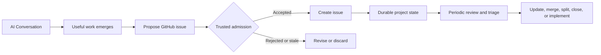

_By Ryan Jennings. Adapted for Micrantha Architecture Notes from [the personal essay](https://ryanjennin.gs/posts/ai-chat-not-a-database/), which remains the canonical edition._

The AI did not crash.

It just forgot a constraint.

That is a stranger failure mode than a missing row, a failed transaction, or a
process terminating with a stack trace. Nothing necessarily looks broken. The
assistant can keep talking, reasoning, and producing plausible work while using
a different set of facts than the one you think you established earlier.

This becomes obvious in long-running engineering conversations. A design starts
with a constraint such as:

> Remote inference is forbidden unless explicitly authorized.

Hours, days, or sessions later, that constraint may no longer be present in the
model's active context. The transcript might still exist. A summary might
preserve the general architecture. A memory system might retrieve related facts.

Those are different layers:

```text
conversation retained by product
        !=
conversation supplied to model
        !=
model working context
        !=
retrieved memory
        !=
durable application state
```

The system does not need to throw an error when they diverge.

It can just make a different decision.

That makes conversational loss a correctness problem and, for systems that can
act, a governance problem.

<Figure
  title="Conversational context and durable state"
  caption="AI memory supports retrieval; the system of record holds accepted current state."
  src="/img/blog/ai-chat-not-a-database.webp"
  alt="Editorial illustration accompanying a discussion of conversation memory and authoritative application state."
/>

## Conversation is context, not state

A chat interface creates a strong illusion of continuity. Humans see one thread.
The underlying system may be working from a bounded context window, compacted
history, summaries, retrieved memories, selected tool output, files, project
context, or some combination of those.

That is not inherently bad. Sending an entire lifetime of interaction into every
model call would be expensive, noisy, and increasingly counterproductive.

The architectural mistake is assuming that because something was once said in a
conversation, it is now accepted, current, and authoritative. Memory can be
persisted in a database and still be the wrong source of truth for a decision.

I find it useful to separate three classes of information:

1. **Ephemeral conversational context** -- useful for the current interaction
   and safe to lose.
2. **Durable working state** -- decisions, constraints, requirements, open
   questions, task status, and current project assumptions.
3. **Evidence** -- source documents, commits, test results, measurements,
   approvals, citations, and other material that explains why state exists.

Putting all three into one rolling token stream is convenient until the stream
becomes the only copy.

## Retention is not enough

Saving transcripts is useful:

```text
chat -> transcript.md
```

A complete, accessible export can be useful recovery evidence. A transcript
alone is not necessarily a complete backup: tool effects, missing attachments,
retention limits, deletions, and partial exports can leave gaps. It also does
not provide state management.

For consequential information, the path needs another step:

```text
chat / retrieved evidence
          |
          v
    extract candidate
          |
          v
       proposal
          |
          v
 trusted admission (policy + acceptance)
          |
     +----+----+
     |         |
  accepted   rejected / stale
     |         |
     v         v
 versioned   revise or discard
 system of record
```

I think of this as four related operations:

- **Retention** keeps whatever conversation record was captured and remains
  accessible.
- **Extraction** identifies information that may deserve a durable
  representation.
- **Promotion** moves consequential information into the appropriate system of
  record.
- **Reconciliation** checks whether promoted state is still correct, duplicated,
  superseded, completed, or contradicted by newer evidence.

Reconciliation matters because externalizing memory creates its own entropy. A
hundred extracted facts are not automatically better than one long chat, and a
hundred stale GitHub issues are not a knowledge system.

## The boring system of record is often the right one

One pattern I use is to move work out of AI conversations and into GitHub issues.
Once an idea becomes real work, the issue gets a stable identifier, history,
status, links to code, and a lifecycle independent of the originating chat.

Later, review can look for overlap, stale assumptions, superseded work,
completed implementation, issues that should merge, and plans that should split.



That loop is effectively garbage collection and consistency maintenance for
extracted conversational state.

GitHub is not an AI memory product. That is part of why the pattern works.
Engineering already has systems with useful semantics:

- **Work item:** GitHub issue
- **Architectural decision:** ADR
- **Design proposal:** RFC
- **Implementation:** Git
- **Test result:** CI evidence
- **Operational fact:** telemetry / event store
- **Authorization:** capability / policy record
- **Original discussion:** transcript / archive

The AI does not need to own the state. It needs to synchronize its reasoning
with the systems that do.

## Memory needs maintenance too

Humans do not always recognize the important fragment at the moment it appears.
A constraint may emerge halfway through exploration. An observation may only
look important after it recurs in several sessions. A design branch may be
abandoned without anyone recording why.

That suggests a maintenance agent, but not one that blindly turns every chat
into memory:

```text
sessions / evidence
       |
       v
candidate extraction / classification
       |
       v
dedupe / conflict detection
       |
       v
proposed promotion
       |
       v
trusted admission + revision check
       |
  +----+----+
  |         |
accepted  stale / rejected
  |         |
  v         v
versioned   reconcile or discard
system of record
  |
  v
derived memory projection (context only)
```

It should look for decisions, constraints, unresolved questions, recurring
preferences, project relationships, evidence references, tasks, and superseding
statements. It should also know what _not_ to promote: brainstorming,
speculation, ambiguous remarks, duplicate summaries, and conclusions without
supporting evidence.

I would give such an agent **proposal rights, not arbitrary authority over
consequential state**.

Low-risk memory updates may be admitted automatically under narrow policy. A
candidate architecture decision becomes a _proposed_ ADR; a discovered task
becomes a _proposed_ issue. Changes to constraints, policy, or authority need
stronger acceptance. The extractor should not have arbitrary downstream writes.

### The admission contract

Consider the opening constraint: remote inference is prohibited unless
explicitly authorized. An agent may extract that candidate, but extraction
does not make it current policy. An illustrative promotion contract is:

```yaml
candidate:
  kind: project_constraint
  subject: project/example
  key: remote_inference_allowed
  value: false
  source_ref: transcript/message-123
  source_digest: "<source-digest>"
  status: proposed

admission:
  expected_revision: 41
  actor: user/project-owner
  scope: project/example
  policy_ref: project-constraints-v2
  candidate_digest: "<candidate-digest>"
  approval_ref: approval-456

accepted_record:
  revision: 42
  subject: project/example
  key: remote_inference_allowed
  value: false
  candidate_digest: "<candidate-digest>"
  policy_ref: project-constraints-v2
  accepted_by: user/project-owner
  approval_ref: approval-456
```

These are illustrative identifiers and digests, not a prescribed schema or
actual computed hashes. The approval receipt must bind the _exact_ candidate,
actor, scope, and policy version; merely including those fields in agent output
does not prove acceptance. A trusted admission service verifies that binding
and compares the expected revision with current state **atomically** before
committing revision 42. A conflict must not silently overwrite newer state.

This gate can be automated for low-impact metadata. The essential distinction
is between a memory candidate that may inform reasoning and an accepted
transition that other services are entitled to enforce.

Promotion is also a persistence boundary: accepted information may influence
future reasoning after its source leaves the active context. Provenance, scope,
and acceptance evidence must therefore survive the original session.

An old conversational approval should also never silently become durable
authorization. Memory may record that approval happened; the authorization
system must independently determine whether it is valid now, for this actor,
resource, and action.

### Reconciliation under concurrency and failure

Promotion is a state-changing operation, not periodic prompt cleanup. Use
versioned compare-and-swap writes, scoped actor identities, idempotency keys,
and a separately protected audit record. Concurrent agents should encounter
a revision conflict rather than use last-writer-wins for consequential facts.

If a write times out after reaching the store, its result may be
**indeterminate**. Blind retries can create duplicate issues, conflicting
decisions, or repeated effects. Query an operation receipt and the
authoritative record before deciding to retry. Escalate ambiguity where
the consequences cannot be safely repeated.

A memory index may remain stale while reconciliation catches up. That can
be acceptable for suggestions, never for permission checks: the effect
boundary must validate current authoritative state where it matters.
For asynchronous or externally executed work, a check before dispatch alone
cannot eliminate the race with subsequent revocation. Admission must be
fenced or revalidated at the actual effect sink where feasible, and
indeterminate external outcomes must be recorded rather than treated as
canceled or automatically safe to retry. Revocation cannot undo an effect
that has already committed.

## A seed can grow the context back

There is another recovery pattern I use constantly, even without formal memory
infrastructure.

I rarely remember the exact missing chat. I remember a fragment: a project name,
a phrase, an old issue, a decision, or a strange connection between two systems.
That fragment is a **seed**.

A useful system should be able to grow context back around it:

```text
seed
  |
  +--> search old sessions
  +--> search issues / commits / docs
  +--> retrieve related evidence
  +--> reconstruct the surrounding decision
  +--> discover adjacent information
```

The seed does not need to be an exact quote. It can be semantic: "the runner
isolation discussion", "the Postgres versus Redis memory idea", or "the issue
where we decided remote inference was forbidden."

Three different operations are hiding inside that workflow:

- **Recovery** finds information that actually existed.
- **Reconstruction** rebuilds useful context around the recovered fragment.
- **Discovery** asks what else is related now: newer evidence, contradictions,
  issues, decisions, or research that did not exist in the original
  conversation.

The provenance should remain explicit:

```text
recovered_from_history
reconstructed_from_history
newly_derived
newly_researched
```

Otherwise a plausible inference discovered today can quietly become something
we supposedly decided six months ago.

> **A seed is a retrieval handle, not truth.**

AI is exceptionally good at making coherent narratives from fragments. That
same strength creates a confirmation-bias risk: a model can find connections
because we asked it to find connections. Recovered evidence needs to remain
visible, and the system should be able to answer not only _what_ it found but
_how it knows_.

Session lists and bulk exports are useful here mainly as a recovery path. They
can inventory old conversations and surface state that should have been promoted
earlier. They are not a substitute for promoting consequential information when
we first recognize it.

## Memory is a projection of history

The research literature and product implementations are converging on a similar
shape: retain interaction history, extract candidate memories, consolidate them,
and retrieve a compact working view later.

Research such as LoCoMo and LongMemEval shows why long context alone is not the
whole problem. Long-term interaction also requires temporal reasoning, knowledge
updates, multi-session reasoning, and knowing when old information has been
superseded. Other systems explore reflection, hierarchy, temporal history, and
selective forgetting.

The implementations differ, and no single architecture has won. But the common
idea is useful:

> **Memory is a maintained projection over history, not an ever-growing prompt.**

The database analogy is useful, but ordinary chat retention is not the
same as an event log:

```text
retained chat         = potential evidence source
governed event log   = ordered, attributed history (if implemented)
memory index         = derived, replaceable context projection
authoritative store  = versioned state and accepted transitions
```

A retained transcript is not automatically complete, durable, ordered with
tool effects, or integrity-protected. An actual event log needs explicit
identity, sequencing, access controls, integrity and retention semantics.

Nor is memory reconstruction necessarily deterministic. Replay may require
source references, extractor model/version, prompts, policies, and processing
configuration. A compact memory view can evolve without rewriting its
source evidence, but replay claims must match what was actually retained.

The provider references below illustrate variants of extraction,
consolidation, and retrieval. Their feature sets and terminology may change;
the architectural distinction does not depend on any one implementation.

## Remembered state is not authoritative state

A memory system may remember:

> We need to isolate self-hosted runners.

A GitHub issue can say whether that work is planned, assigned, implemented,
blocked, superseded, or closed.

A memory system may remember:

> We decided Postgres should be authoritative.

An ADR can capture the decision, alternatives, consequences, and the fact that a
later ADR superseded it.

A memory system may remember:

> The user approved repository A.

A capability or policy system can determine whether that authority still exists
and exactly what it permits.

These are operational differences, not merely semantic ones.

A memory store contains state, but its entries are typically **derived
observations**: incomplete, stale, conflicting, or scoped to a particular
session. The system of record determines what was accepted, which revision
is current, and who can change it.

This complements
[Intent Is Security State, Not Conversation History](https://micrantha.com/blog/intent-is-security-state),
which addresses the narrower authorization problem: consequential decisions
must bind accepted current intent, not retrieved historical text.

## Memory is a security boundary

Retrieved memories and source documents are **untrusted input**, including
those stored yesterday by a legitimate service. A retrieved note may contain
injected instructions, stale permissions, or data from another tenant. It
must not grant its own authority or instruct the promotion gate to bypass
policy.

The privacy boundary extends to summaries, embeddings, caches, exports,
and search indexes. Enforce user, tenant, and project scope on retrieval and
promotion. Minimize sensitive content, assign retention rules, and propagate
correction or deletion to derivatives and backups as the product's policies
permit.

An append-only audit history should not become an excuse to retain sensitive
source content indefinitely. Preserve only the minimal authorized integrity
and transition metadata; expire or delete sensitive payloads and derived
copies under the applicable retention rules, using scoped tombstones or
redaction receipts where appropriate. Immutable logs, backups, and legal
retention obligations need explicit treatment: a retained digest or receipt
does not, by itself, establish that every copy was erased.

Test poisoned retrieval, cross-tenant leakage, stale summaries, revoked
access, and redacted sources. None should become authoritative by accident.

## Make forgetting safe

Long context windows are useful. Retrieval is useful. Summaries, persistent
memory, and session export are useful.

None of them should carry the full burden of system correctness.

The opening constraint makes this testable. Remove the sentence forbidding
remote inference from active context, retrieve stale memory claiming it is
allowed, and have an agent propose a remote provider call. The trusted
effect boundary must consult the current project constraint and deny the
call. A subsequent user authorization requires a newly accepted state
revision and independently valid permission; an old chat approval cannot
silently broaden authority.

This test does not prove that the model always remembers correctly. It
shows that **forgetting and unauthorized effects are separated by
enforceable contracts**.

For long-running AI-assisted work, I increasingly want the architecture to make
conversation disposable:

```text
reason in chat
     |
     v
propose what matters
     |
     v
admit and commit accepted state
     |
     v
reconcile it over time
     |
     v
recover missed fragments when necessary
```

The chat can remain exploratory, associative, and lossy. That is part of what
makes it useful. The durable system around it should be much less forgiving.

If losing one sentence from a conversation could materially change system
behaviour, that sentence probably represented state that belonged somewhere
else.

> **The goal is not to make the chat remember everything. The goal is to make
> forgetting the chat safe.**

## References

### Research

- [Park et al., "Generative Agents: Interactive Simulacra of Human Behavior" (UIST 2023)](https://arxiv.org/abs/2304.03442) -- experience, reflection, and retrieval.
- [Packer et al., "MemGPT: Towards LLMs as Operating Systems" (2023)](https://arxiv.org/abs/2310.08560) -- hierarchical memory management around limited context.
- [Zhong et al., "MemoryBank: Enhancing Large Language Models with Long-Term Memory" (2023)](https://arxiv.org/abs/2305.10250) -- continual updates and selective forgetting.
- [Maharana et al., "Evaluating Very Long-Term Conversational Memory of LLM Agents" / LoCoMo (ACL 2024)](https://aclanthology.org/2024.acl-long.747/) -- long-range multi-session conversational-memory evaluation.
- [Wu et al., "LongMemEval: Benchmarking Chat Assistants on Long-Term Interactive Memory" (2024)](https://arxiv.org/abs/2410.10813) -- extraction, temporal reasoning, updates, and abstention.
- [Banerjee et al., "APEX-MEM" (ACL 2026)](https://aclanthology.org/2026.acl-long.749/) -- append-only temporal history and conflict-aware retrieval.
- [Li et al., "TiMem" (Findings of ACL 2026)](https://aclanthology.org/2026.findings-acl.1091/) -- temporal-hierarchical memory consolidation.
- [Li et al., "Locomo-Plus" (ACL 2026)](https://aclanthology.org/2026.acl-long.1150/) -- evaluation beyond explicit factual recall.
- [Wu et al., "LongMemEval-V2" (2026)](https://arxiv.org/abs/2605.12493) -- environment-specific state, workflows, and operational experience.

### Provider implementations

- [OpenAI Agents SDK: Agent Memory](https://openai.github.io/openai-agents-python/sandbox/memory/) -- sandbox-agent memory, distinct from the SDK conversational Session store and from consumer ChatGPT memory; covers extraction, consolidation, retrieval, and stale-memory repair.
- [Anthropic: Claude chat search and memory](https://support.claude.com/en/articles/11817273-use-claude-s-chat-search-and-memory-to-build-on-previous-context) -- cross-chat retrieval and maintained memory.
- [Microsoft Foundry: What is Memory?](https://learn.microsoft.com/azure/foundry/agents/concepts/what-is-memory) -- extraction, consolidation, conflict resolution, and retrieval.
- [Google Gemini Enterprise Agent Platform: Memory Bank IngestEvents](https://docs.cloud.google.com/gemini-enterprise-agent-platform/scale/memory-bank/ingest-events) and [Memory Revisions](https://docs.cloud.google.com/gemini-enterprise-agent-platform/scale/memory-bank/revisions) -- continuous ingestion and immutable memory revisions.
- [Amazon Bedrock AgentCore: Episodic Memory Strategy](https://docs.aws.amazon.com/bedrock-agentcore/latest/devguide/episodic-memory-strategy.html) -- extraction, consolidation, and cross-episode reflection.
