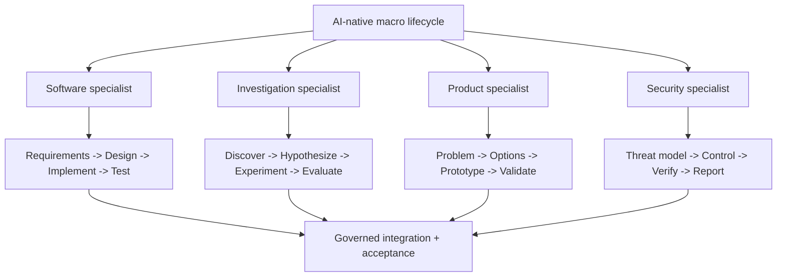
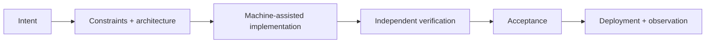
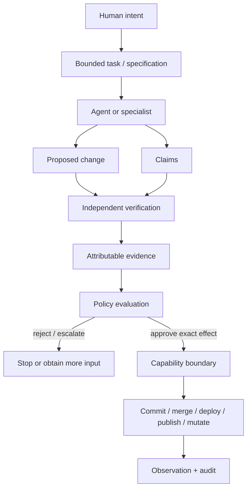
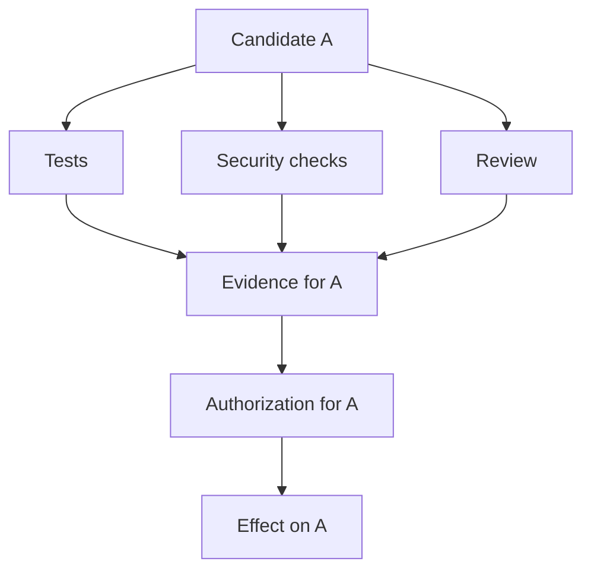
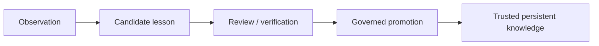
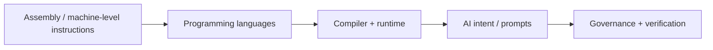
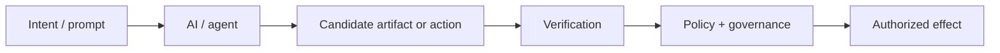

_By Ryan Jennings. Adapted for Micrantha Architecture Notes from [the personal edition](https://ryanjennin.gs/posts/ai-native-sdlc-governed-software-delivery/), which remains the canonical source._

<Figure
  title="From AI-Native SDLC to Governed Software Delivery"
  caption="Governed delivery distinguishes generation from verification, authorization, and observed effects."
  src="/img/blog/ai-native-sdlc-governed-software-delivery.webp"
  alt="Illustration for AI-native software development and governed delivery."
/>

Andre Kaminski's [_The AI-Native Software Development Lifecycle_](https://www.amazon.com/s?k=The+AI-Native+Software+Development+Lifecycle+Andre+Kaminski) puts a useful
name around a change I have been feeling in my own engineering work: once AI can
produce code, tests, documentation, migrations, and implementation alternatives
quickly, **implementation is no longer the obvious organizing constraint of the
software-development lifecycle**.

That does not make engineering easier. It moves the bottleneck.

The scarce resource becomes confidence: knowing that a proposed change matches
intent, respects architecture and policy, is independently verified, and is
actually authorized to affect the system.

That is where the book's framing overlaps strongly with the architecture I have
been building across Anthesis, Dubnium, Invokrum, Keylix, and the
agent-delivery playbook.

But there is also an important difference.

The book is intentionally somewhat absolutist. Saying that traditional software
development has "died" is useful rhetoric because it forces the scale of the
change into view. I do not read it literally.

Traditional SDLC and product-development models are still useful. What changes
is where they sit.

At the **macro level**, the overall delivery system becomes AI-native: work is
decomposed, routed to specialists, executed in bounded loops, verified, governed,
and assembled into a larger outcome.

At the **micro level**, an individual specialist may still use a very traditional
lifecycle inside its prompt or execution loop:



Those patterns did not become wrong. They became composable subroutines.

The distinction I find most useful is therefore:

> **AI-native macro, traditional micro.**

A mature agentic system can preserve decades of useful engineering and product
practice inside specialist loops without requiring the entire organization to be
structured around the assumption that humans manually execute every lifecycle
stage.

The [AI-native SDLC](https://theainativeproject.org/ai-software-development-lifecycle/) is primarily a **lifecycle and organizational model**. My
work increasingly treats AI-native development as an **authority and evidence
problem** as well.

## Where I agree

The traditional delivery model is implicitly organized around expensive human
implementation:


When implementation becomes cheap, the surrounding work becomes relatively more
important:



This matches how I already try to work with coding agents:

1. define the problem, constraints, and expected evidence;
2. let a model propose or implement a bounded change;
3. inspect the diff rather than trusting the explanation;
4. run tests, static analysis, builds, and security checks;
5. feed failures back into another bounded iteration;
6. accept the change only when the evidence supports it.

The useful mental model is:

> **Generation is cheap. Trustworthy acceptance is expensive.**

That is a much better optimization target than "how many lines of code can an
agent write?"

Kiro's [_Frontier Engineering_](https://kiro.dev/topics/frontier-engineering/)
principles independently land on several of the same operational conclusions:
engineers increasingly architect intent rather than type implementation, codebases
need to be legible to agents, feedback should be executable and fast, and trust
should be placed in enforced boundaries rather than in the agent itself. Its
strongest contribution for me is not the productivity rhetoric but the systems
framing around constrained autonomy and continuously improving the surrounding
agent harness.

I treat that as practitioner evidence of an emerging engineering pattern, not as
empirical validation. Kiro does not publish enough methodology on those pages to
support its stronger quantitative productivity claims, so I would not use them as
evidence for the magnitude of the shift.

It also explains why traditional lifecycle discipline still matters inside the
system. If one specialist is implementing a bounded component, the familiar
sequence of requirements, design, implementation, tests, and review can still be
exactly the right local control loop. The difference is that the outer system can
instantiate, compose, repeat, or replace that loop dynamically rather than making
it the shape of the entire delivery organization.

## Where my architecture goes further

A lifecycle model can say that an agent should implement a task and that quality
gates should verify it. A production control architecture also has to answer
questions such as:

- Which agent is this?
- On whose behalf is it acting?
- Which repository, branch, tool, or environment may it touch?
- Which exact operation was authorized?
- Is the evidence about the same candidate that will be merged or deployed?
- Has anything policy-relevant changed since approval?
- Can a verifier accidentally grant authority?
- Can an agent promote its own output into trusted memory or policy?
- What happens when a repair loop keeps failing?

Those questions are the difference between **AI-assisted workflow** and
**governed actuation**.

The architecture I am converging on looks closer to this:



The key distinction is that several things which are often collapsed into
"agent autonomy" remain separate.

### Evidence is not authority

A passing test, a successful security check, or a model saying "this looks
correct" is evidence.

It is not permission.

Anthesis is intended to interpret evidence through policy and approval rules.
The verifier does not get to promote its own result into authorization.

### Identity is not inherited implicitly

An agent should not simply inherit the full authority of the human who launched
it.

Keylix and related identity work treat agents and execution components as
distinct principals where practical, with attributable credentials and bounded
delegation.

That matters as soon as an agent can do more than edit a scratch buffer.

### Capabilities bound effects

The most consequential boundary is not model inference. It is mutation.

Reading a repository and proposing a patch is relatively low-risk. Committing,
signing, merging, deploying, publishing, deleting, rotating credentials, or
changing policy are qualitatively different operations.

Dubnium's orchestration and capability-gateway work therefore tries to keep
reasoning separate from effect authority.

The agent can ask.

The boundary decides whether the effect is allowed.

### Verification must bind to the exact candidate

"Tests passed" is not useful evidence if the tested artifact is not exactly the
artifact that will be merged or deployed.

The workflow therefore needs provenance and exact-subject binding:



If the candidate changes, relevant evidence and authorization may need to be
re-established.

### Learning is also a governed effect

Agent memory is another place where authority can quietly leak.

A failed agent run should not be able to write "the correct way to do this" into
trusted project knowledge merely because it reached a conclusion.

I increasingly treat learning as a promotion pipeline:



This is the same separation-of-duties principle applied to memory.

## How the projects divide the problem

The pieces are intentionally separate rather than becoming one giant
"AI platform":

- **agent-delivery-playbook** defines the vendor-neutral workflow, trust model,
  evidence expectations, risk tiers, and enforcement mapping.
- **Dubnium** owns local orchestration, model/runtime boundaries, specialists,
  scheduling, and bounded execution paths.
- **Anthesis** focuses on policy, approvals, evidence interpretation,
  provenance, and governed decisions.
- **Invokrum** provides portable invocation and execution-evidence contracts.
- **Keylix** handles identity and security properties such as sender binding.
- Capability gateways sit at the boundary where a proposal becomes a mutable
  operation.

That split is deliberate. Orchestration should not silently become policy.
Verification should not become authorization. A portable evidence schema should
not become the executor. A model should not become the security boundary.

## The resulting workflow

The practical workflow is therefore slightly stricter than the generic
AI-native SDLC:


Humans do not need to manually perform every step. In fact, the point is to
automate more of them.

But automation should remove mechanical work without erasing the distinctions
that make the result trustworthy.

## A small AI-role taxonomy

"AI" is now broad enough that it often hides more than it explains. I find it
useful to separate a few kinds of work:

- \***\*AI Research\*\*** — New models, algorithms, architectures, and learning methods
- \***\*ML / Data Science\*\*** — Statistical modeling, experiments, inference, and evaluation
- \***\*AI Engineering\*\*** — Production AI systems, inference, agents, evals, reliability, and observability
- \***\*Applied AI\*\*** — Applying AI to concrete product, workflow, or domain problems
- \***\*AI Platform / Governance\*\*** — Identity, capabilities, policy, provenance, audit, orchestration, and organizational controls
- \***\*Business AI\*\*** — Commercial and operational applications such as sales, support, product operations, and decision support

These overlap. They are not credentials or status levels; they are useful labels
for the primary problem being solved.

My own work currently sits mostly at the intersection of **Applied AI, AI
Engineering, and AI Platform / Governance**, with software architecture and
security cutting across all three.

That distinction matters because simply _using_ an AI system is not the same as
engineering one, just as using a database does not make every application role
database engineering.

## Another abstraction layer

There is another way I think about this transition.

Software development has repeatedly moved upward through layers of abstraction:



Assembly did not disappear when higher-level languages arrived. It became a
lower-level implementation detail most programmers rarely manipulate directly.

Likewise, programming languages and compilers do not disappear in an AI-native
workflow. They become another execution layer beneath a higher-level interface
based increasingly on intent, constraints, prompts, context, and delegated
tasks.

But there is an important difference.

A compiler is expected to be deterministic with respect to its input and
language semantics. An AI system is probabilistic, context-sensitive, and often
capable of invoking tools or causing side effects.

So the next abstraction layer cannot be just:

```text
natural language -> code
```

It needs to be closer to:



That is why governance is not an optional wrapper around AI-assisted
development. It plays part of the role that type systems, compilers, runtimes,
test systems, and operating-system boundaries have played at earlier abstraction
layers: constraining what a more expressive interface is allowed to turn into.

The analogy is not exact, but it captures the direction:

> **assembly -> programming language/compiler -> AI/prompts/governance**

Each layer raises the level at which humans express intent. Each lower layer
still matters. And each increase in expressive power needs a corresponding
control system beneath it.

## The deeper shift

The interesting consequence of AI-native development is not that programmers
type less code.

It is that **software engineering becomes increasingly concerned with the
control system around code generation**.

The engineering questions move from:

> Can we produce this implementation?

toward:

> Can we establish, cheaply and repeatedly, that this is the implementation we
> intended, that it satisfies the required properties, and that the actor
> applying it has exactly the authority needed to do so?

That is the part of the AI-native transition I find most interesting.

The code generator may eventually become almost interchangeable.

The architecture that decides what to trust, what to permit, and what evidence
is sufficient will not.
